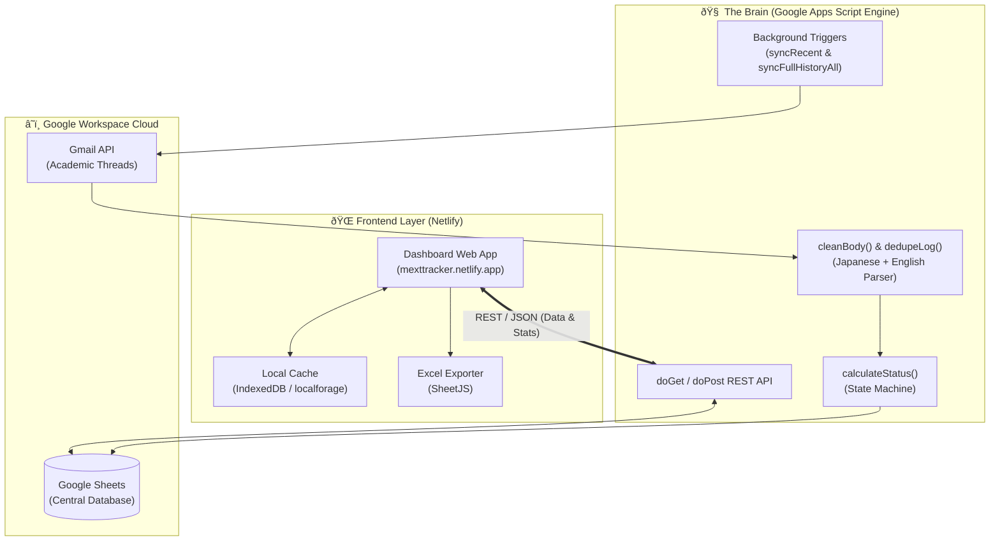

# 🌸 Japan MEXT Scholarship Supervisor Outreach & LoA Tracker

<div align="center">

[](https://mexttracker.netlify.app/)
[](https://developers.google.com/apps-script)
[](https://www.google.com/sheets/about/)
[](https://mail.google.com/)
[](LICENSE)

**An automated academic CRM and supervisor correspondence tracker tailored for Japanese Government (MEXT / Monbukagakusho) Scholarship applicants.**

[Explore Live Dashboard ↗](https://mexttracker.netlify.app/) • [Report Bug](https://github.com/khizarlatif/MEXT_Tracker/issues) • [Request Feature](https://github.com/khizarlatif/MEXT_Tracker/issues)

</div>

---

## 📌 Overview

Securing a **Letter of Acceptance (LoA / 内諾書)** from a Japanese professor (Sensei) at premier institutions (*The University of Tokyo, Kyoto University, Osaka University, Tohoku University, Tokyo Tech, etc.*) is the decisive step for both **Embassy Recommendation** and **University Recommendation** tracks of the MEXT scholarship.

Cold emailing Japanese professors requires rigorous etiquette, precise follow-up timing, and meticulous organization. **MEXT Tracker** is an end-to-end management suite designed to automate this workflow:
- **Netlify Web Dashboard:** Fast, aesthetic dark-mode interface with live conversion KPIs, search, filtering, and modal conversation timelines.
- **Backend Brain ("The Engine"):** A serverless **Google Apps Script** running 24/7 that synchronizes with Gmail, cleans Japanese/English email quotes, and computes outreach status automatically.
- **Cloud Database:** A linked **Google Sheet** that stores all professor profiles, correspondence history, and status flags in real time.

---

## âš¡ Key Features

- 🎯 **MEXT Outreach KPI Dashboard**
  - Instant conversion metrics: Total Sensei Contacted, Response Rate %, LoA / Acceptance %, and Action Required flags.
  - Color-coded status pipeline (`Accepted (LoA)`, `Action Required`, `Awaiting Reply`, `Ignored`, `Rejected`, `Ghosted`).

- 📬 **Automated Gmail Synchronization**
  - Background cron runs every 8 hours scanning recent exchanges (`newer_than:2d`).
  - Distinguishes between professor replies and candidate follow-ups.
  - Automatically filters out bounce notifications, postmasters, and automated vacation/out-of-office replies (`自動返信`, `不在`, etc.).

- 🇯🇵 **Japanese Academic Quote & Signature Parser**
  - Specialized regex patterns strip Japanese reply headers (`元のメッセージ`, `転送メッセージ`, `〇〇先生/様より書きました/送信しました`, `iPhone から送信`).
  - Deduplicates repeated email quotation blocks to keep threads concise and readable.

- ⏳ **Resilient Multi-Chunk Full Sync**
  - Automated self-triggering time limits safely bypass Google Apps Script's 6-minute ceiling when processing deep email histories.

- 🔍 **Instant Search & Multi-Criteria Filtering**
  - Live search across Professor Name, University, Laboratory Research Field, and Email.
  - Quick filters by thread state and urgency level.

- 💾 **Offline Caching & 1-Click XLSX Export**
  - Powered by `localforage` (IndexedDB) for offline readiness and instant page reloads.
  - Integrated `SheetJS (XLSX)` for instant export to Excel spreadsheets.

---

## 🏗️ Architecture & Data Flow



---

## 🔄 Interaction Lifecycle & Status Rules

| Status | Trigger Condition | Visual Tag |
| :--- | :--- | :---: |
| **Not Contacted** | Newly added professor profile; no outreach email sent yet | `⚪ Gray` |
| **Awaiting Reply** | Outreach email sent; waiting for Sensei response (< 14 days) | `🟡 Amber` |
| **Action Required** | Sensei has replied and expects an answer, or follow-up deadline is due (> 7 days) | `🟠 Orange` |
| **Accepted** | Informal consent, interview offer, or **Letter of Acceptance (LoA)** issued | `🟢 Mint Green` |
| **Ignored** | No reply received after standard waiting threshold (> 14 days) | `🟣 Purple` |
| **Rejected** | Laboratory capacity full or research alignment mismatch | `🔴 Red` |
| **Ghosted** | Sensei ceased communication after initial interest | `🔵 Indigo` |

---

## 🚀 Setup & Deployment Guide

### 1. Create your Google Sheet
1. Create a new [Google Sheet](https://sheets.new).
2. Name the tab `Sheet1`.
3. Set the following column headers in Row 1:
   ```text
   Professor | University | Research Interest | Email | Linked_Email | Email_Logs | Last_Contact | Thread_State | Notes | Reply_Status
   ```

### 2. Deploy the Apps Script Backend ("The Brain")
1. In your Google Sheet, open **Extensions** > **Apps Script**.
2. Replace all placeholder code with the code from [`backend_template.js`](backend_template.js).
3. Configure your personal settings at the top of the file:
   ```javascript
   var TRACKER_SHEET_URL         = "YOUR_GOOGLE_SHEET_URL";
   var TRACKER_SHEET_NAME        = "Sheet1";
   var TRACKER_USER_EMAIL        = "your-email@gmail.com";
   var IGNORED_DAYS_THRESHOLD         = 14;
   var ACTION_REQUIRED_DAYS_THRESHOLD = 7;
   ```
4. Click **Deploy** > **New deployment**.
5. Choose **Web app**:
   - **Execute as:** `Me (your account)`
   - **Who has access:** `Anyone`
6. Copy your **Web App URL**.

### 3. Add Background Automation Triggers
1. In the Apps Script sidebar, click the **Triggers (⏰)** icon.
2. Click **Add Trigger** (bottom right):
   - **Choose which function to run:** `syncRecent`
   - **Select event source:** `Time-driven`
   - **Select type of time based trigger:** `Hour timer` -> `Every 8 hours`
3. Click **Save** and grant the requested permissions.

### 4. Deploy Frontend to Netlify
1. Fork or clone this repository.
2. In `index.html`, verify or paste your Google Apps Script Web App URL.
3. Deploy to [Netlify](https://www.netlify.com/):
   - Drag and drop the repo folder, or connect your GitHub repository for continuous deployments.
4. Access your tracker live on Netlify!

---

## 🛠️ Tech Stack

- **Frontend:** HTML5, CSS3 Custom Modern Dark UI, Vanilla JavaScript (ES6+)
- **Libraries:**
  - [SheetJS (xlsx.full.min.js)](https://cdn.sheetjs.com/) — 1-click spreadsheet export
  - [LocalForage](https://github.com/localForage/localForage) — High performance client caching via IndexedDB
  - [Nunito Google Font](https://fonts.google.com/specimen/Nunito) — Clean modern UI typography
- **Backend:** Serverless Google Apps Script (GAS) runtime
- **Services:** Gmail API, Google Sheets API, Netlify Edge Hosting

---

## 🤝 Contributing

Contributions and enhancements are welcomed!
1. Fork the Project (`gh repo fork khizarlatif/MEXT_Tracker`)
2. Create your Feature Branch (`git checkout -b feature/NewFeature`)
3. Commit your Changes (`git commit -m 'Add NewFeature'`)
4. Push to the Branch (`git push origin feature/NewFeature`)
5. Open a Pull Request

---

## 📄 License

Distributed under the MIT License. See `LICENSE` for more information.

<div align="center">

Built with ❤️ by [Khizar Latif](https://github.com/khizarlatif)

</div>
